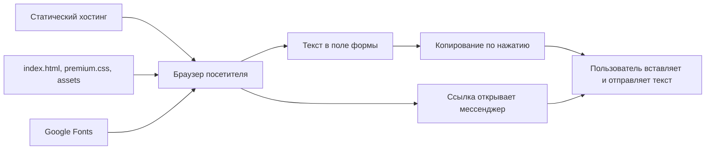

# Архитектура

## Реализованный продукт

Статический сайт-портфолио Марины Чайки на HTML, CSS и обычном JavaScript. Показывает услуги, цены и проекты. Пример ИИ-помощника на первом экране — демонстрация, не живой чат.

Собственного сервера, API, базы данных, авторизации, платежей и обращения к нейросетям нет. Хостинг отдаёт файлы; сценарии выполняются в браузере.

## Части проекта

| Часть | Где находится и что делает |
| --- | --- |
| Главная страница | `index.html`: предложение, пример ответа, квиз, автор, услуги, кейсы, процесс, цены, контакты и FAQ |
| Базовый CSS | Встроенный `<style>` в `index.html` |
| Текущий дизайн | `premium.css`, подключён после встроенного CSS и переопределяет его |
| Общий JavaScript | Первый встроенный скрипт: тема, навигация, меню, FAQ, контактная форма |
| Квиз | Второй встроенный скрипт: шаги, проверка ответов, подготовка и копирование запроса |
| Изображения | `assets/marina-chaika.png`, `assets/ai-assistant/`, `assets/online-booking/`, `assets/direct-reports/` |
| Политика | `privacy.html`, отдельная страница со своими стилями |
| Размещение | `.openai/hosting.json` содержит только идентификатор проекта Sites |

В HTML и скриптах остались счётчики и эффекты прежнего дизайна. Текущий CSS скрывает `.stats`, `.hero-bg`, `.glow`, `.floating-cta`, `.to-top` и отключает часть эффектов. Их наличие в коде не означает, что посетитель их видит.

## Данные и связи

Базы данных нет. Данные посетителя находятся в полях DOM и переменных JavaScript. Код не использует cookies, localStorage или sessionStorage. При перезагрузке его состояние сбрасывается; браузер может отдельно предлагать автозаполнение.

| Сценарий | Вход | Результат |
| --- | --- | --- |
| `leadForm` | Имя, email, сообщение | Текст в `preparedMessage`, показ панели `successPanel` |
| `reviewForm` | Сфера, цель, имя, описание задачи, необязательная ссылка | Текст в `reviewMessage`, показ `reviewResult` |
| Переключатель темы | Нажатие кнопки | Меняет `data-theme` на `<html>`; начальная тема светлая, выбор не сохраняется |
| FAQ | Нажатие вопроса | Открывает один ответ, закрывает остальные |
| Мобильное меню | Кнопка, ссылка или Escape | Меняет видимость, `inert`, `aria-expanded` и клавиатурный фокус |

Контактная форма проверяет обязательные поля, формат email, длину имени от 2 и сообщения от 5 символов. Квиз требует выбранные ответы первых двух шагов, имя и описание задачи от 5 символов на последнем шаге. При ошибке фокус перемещается к полю; после подготовки — к результату.

Пользовательские данные вставляются в `.value` и `.textContent`. Формы не делают запросов к API и не отправляют сообщения. `navigator.clipboard.writeText` копирует текст по нажатию; при ошибке поле выделяется для ручного копирования. Ссылка `https://t.me/chajjka` открывает Telegram, после чего посетитель сам вставляет и отправляет текст. WhatsApp и email — обычные ссылки, MAX — текстовый номер.

Google Fonts загружает Golos Text и Source Sans 3. При недоступности сети используются системные sans-serif. Хостинг и мессенджеры могут обрабатывать данные по своим правилам; их внутреннее хранение не описывается этим кодом.

## Инструменты проверки

- `verify.cjs`: встроенные модули Node.js `fs` и `vm`; проверяет синтаксис скриптов, дубли ID, якоря и наличие `premium.css`.
- `browser-review.cjs`: `fs`, встроенные `fetch` и `WebSocket`; подключается к уже запущенному браузеру по `http://127.0.0.1:9333/json` через Chrome DevTools Protocol. Делает скриншоты на ширинах 1440 и 390, проверяет меню, FAQ и форму. Сам браузер не запускает.

`browser-review.cjs` открывает жёстко заданный URL `file:///C:/Users/Марина/Documents/Projects/my-lending-test/index.html`; на другом компьютере его нужно изменить. Признаки действий выводятся в консоль; скрипт не превращает каждый отрицательный результат в ошибку выполнения. В рабочей среде использовался Node.js 24. `package.json` не содержит зависимостей, только скрипты запуска проверок.

## Git и размещение

GitHub: `https://github.com/chajjka93-source/my-lending-test`, ветка `main`. Файлы сайта находятся в корне.

В карточке GitHub указана ссылка Vercel. В репозитории нет `vercel.json`, CI-сценариев или команды сборки; настройки Vercel по этому коду не подтверждены.

`.openai/hosting.json` содержит `project_id`, но не `static.directory`. Соседняя копия `archive/migration-2026-10-10/yandex-direct-lending/studio-source` использует `public/` и `dist/` и другую историю Git. Не отправляйте её историю поверх GitHub. Временные credentials публикации не являются ключами сайта и не должны храниться в документах или `.env`.

## Спецификация и реализация

[Спецификация Telegram-бота](thoughts/shared/specs/2026-09-15-beauty-salon-booking-bot.md) описывает план MVP для студий красоты. Это не схема работающего backend этого сайта.

| В спецификации | В текущем коде |
| --- | --- |
| Telegram-бот записи, отмены и переноса | Только описание кейса и скриншоты |
| Панель мастеров, расписание, услуги | Реализации нет |
| Backend и общая база студий | Реализации, миграций и выбранной СУБД нет |
| Напоминания | Серверных задач и очереди нет |
| Подписка и ЮKassa или аналог | Платежей и ключей нет |
| Свободный AI-диалог | За рамками MVP спецификации; на сайте AI API нет |

Планируемые сущности: `Studio`, `Master`, `Service`, `Client`, `Booking`, `Subscription`. Мастер связан со студией, услуга — с мастером, запись — с клиентом, мастером и услугой. Привязка подписки к мастеру или студии оставлена открытым вопросом. Таблиц этих сущностей в репозитории нет.

Спецификация предлагает Node.js или Python, но реализованный стек бота не выбран этим кодом. `research.md` и `design-references.md` — исследования и прошлые варианты дизайна; фактическое поведение определяется исходниками.
